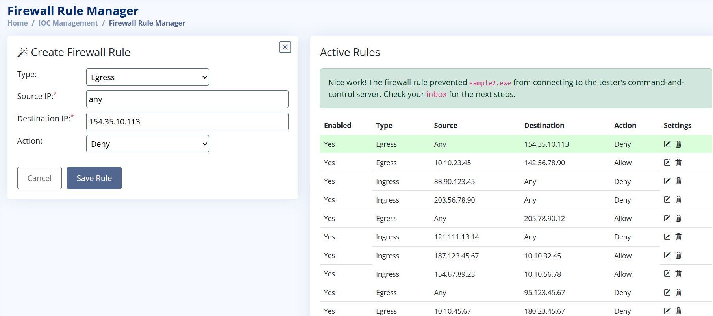
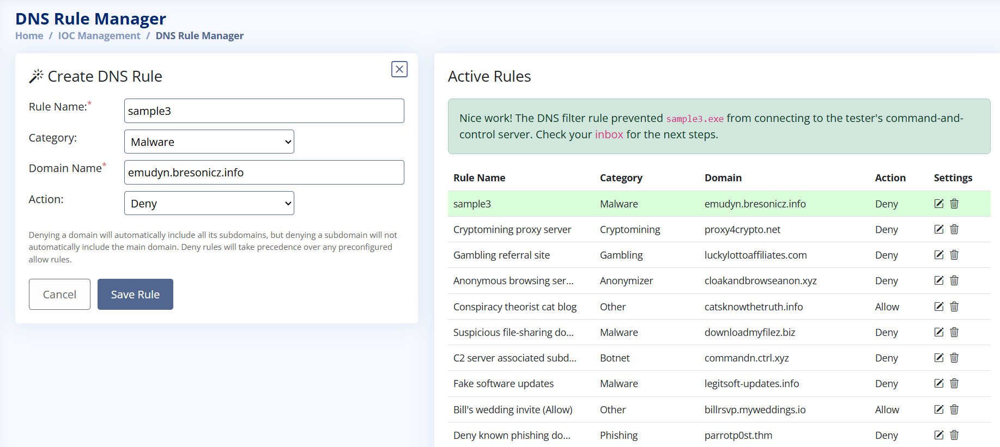
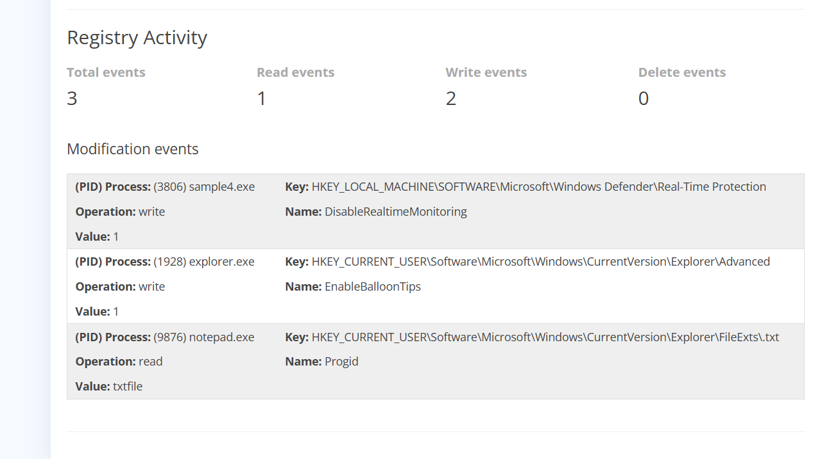
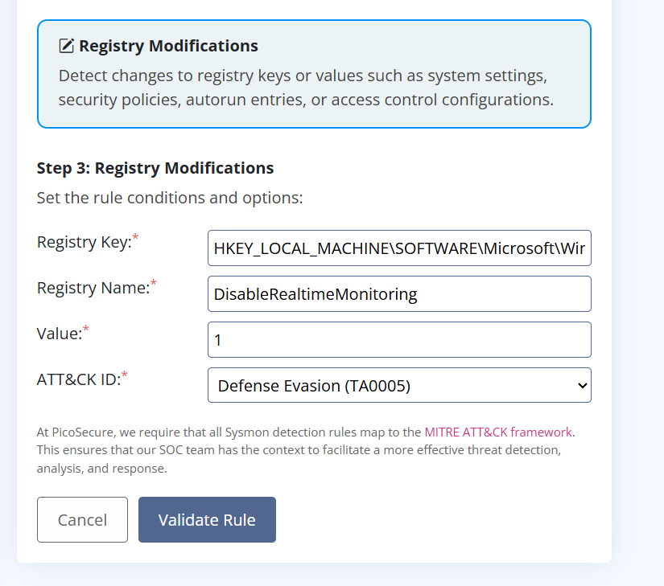
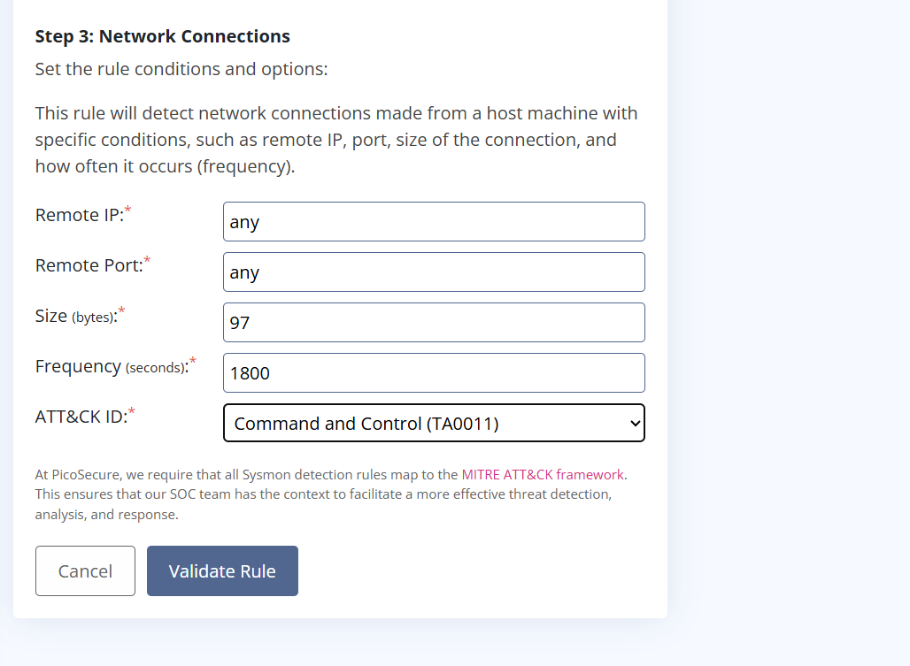
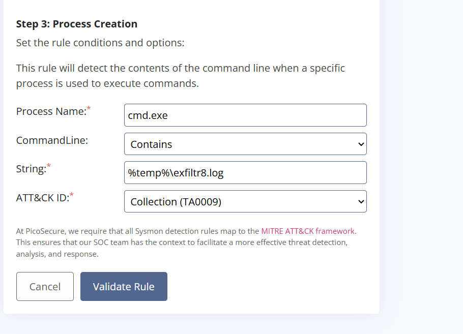

# 🏔️ Summit: Conquering the Pyramid of Pain (TryHackMe Walkthrough)

**Lab Title:** Summit: Conquering the Pyramid of Pain  
**Category:** SOC Level 1 / Detection Engineering & Threat Mitigation  
**Platform:** TryHackMe  
**Status:** Completed  

---

## 📌 Executive Summary
Welcome to **PicoSecure**. Following a series of recent security incidents, management has engaged an external penetration tester for a collaborative **Purple-Team engagement** (cooperative testing between offensive Red Teams and defensive Blue Teams). During this engagement, the penetration tester executes various malware samples (`sample1.exe`, `sample2.exe`, etc.) on a simulated user workstation. 

As Blue Team security analysts and detection engineers, our core mission is to analyze indicators of compromise (IoCs), configure organizational security tools, maximize the operational cost of the adversary, and detect/block malware by systematically working our way up the **Pyramid of Pain**.

---

## 🔺 Conceptual Foundation: The Pyramid of Pain

The Pyramid of Pain is a conceptual model that ranks Indicators of Compromise (IoCs) based on the operational friction and "pain" inflicted on an adversary when those indicators are successfully blocked or mitigated:

```text
        /\          High Pain for Attacker (Difficult to Change)
       /  \         ---------------------------------------------
      /    \        5. TTPs (Behavior, Tactics & Procedures)
     /______\       4. Tools (Utilities & Frameworks)
    /        \      3. Network Artifacts (C2, Domains, IPs)
   /__________\     2. Host Artifacts (Files, Registry keys, Hashes)
  /____________\    1. Hash Values (MD5, SHA-256) - Trivial to Change

Hash Values (MD5 / SHA-256): The base of the pyramid. Blocking a file hash forces the attacker to alter a single bit in their code to generate an entirely new hash, rendering simple signature-based blocking trivial to bypass.

IP Addresses & Network Artifacts: Targeting adversary infrastructure, Command and Control (C2) servers, and connection routing.

Host Artifacts & Domain Names: Identifying unique file names, registry keys, mutexes, and domains associated with the deployment.

Tools: Identifying and blocking the utilities and frameworks utilized by the attacker (e.g., Mimikatz, PsExec, Cobalt Strike).

TTPs (Tactics, Techniques & Procedures): The absolute apex of the pyramid. Focusing on how the adversary behaves rather than what tools they use. Forcing an attacker to change their core methodology creates massive operational disruption.

🛠️ Step-by-Step Lab Walkthrough & Solutions
Upon starting the lab machine and navigating to the provided web interface (https://LAB_WEB_URL.p.thmlabs.com), we interact with a centralized security console to mitigate threats matching each tier of the pyramid.

Task 1: Manage Hashes (Tier 1 Mitigation)
Objective: Identify malicious file hashes generated by early-stage malware samples and add them to the blocklist to prevent execution via file-integrity monitoring or EDR controls.

Analysis: Extracting the SHA-256 file hashes from the analyzed executable samples and submitting them to the hash management interface.


Captured Flag:

Plaintext
THM{f3cbf08151a11a6a331db9c6cf5f4fe4}

Task 2: Firewall Rule Manager (Tier 2 Mitigation - IPs)
Objective: Restrict malicious external communication by analyzing active connection logs and configuring perimeter firewall rules.

Analysis: Identifying external IP addresses associated with C2 callback routines and blocking outbound traffic destined for those endpoints.



Captured Flag:

Plaintext
THM{2ff48a3421a938b388418be273f4806d}

Task 3: DNS Rule Manager (Tier 3 Mitigation - Domains)
Objective: Block domain-based resolution requests targeting known malicious infrastructure used in adversary staging.

Analysis: Extracting anomalous domain queries generated during malware execution and implementing DNS-sinkhole / blocking rules.



Captured Flag:

Plaintext
THM{4eca9e2f61a19ecd5df34c788e7dce16}

Task 4: SIGMA Rule - Sysmon Event Log - Registry Activity
Objective: Write or configure a SIGMA detection rule to catch registry modifications associated with persistence mechanisms.

Analysis: Reviewing Sysmon event logs (such as Event ID 13 - Registry Value Set) to detect unauthorized keys written to CurrentVersion\Run.





Captured Flag:

Plaintext
THM{c956f455fc076aea829799c0876ee399}

Task 5: SIGMA Rule - Sysmon Event Log - Network Connection
Objective: Build a SIGMA rule targeting anomalous outbound network connections characteristic of beaconing behavior.

Analysis: Reviewing outgoing_connections.log (Sysmon Event ID 3 - Network Connection) to flag processes establishing unauthorized TCP connections to non-standard ports.



Captured Flag:

Plaintext
THM{46b21c4410e47dc5729ceadef0fc722e}

Task 6: SIGMA Rule - Sysmon Event Log - Process Creation
Objective: Implement a SIGMA detection rule to capture suspicious process creation chains (e.g., Office applications spawning command-line interpreters).

Analysis: Analyzing commands.log (Sysmon Event ID 1 - Process Creation) to identify parent-child process anomalies, such as winword.exe spawning cmd.exe or powershell.exe.



Captured Flag:

Plaintext
THM{c8951b2ad24bbcbac60c16cf2c83d92c}

🔤 Key Concepts & Terminology Summary
Pyramid of Pain | Purple Team | Hash Blocklist | Firewall Rules | DNS Sinkhole | SIGMA Rules | Sysmon Event Logs | Process Creation | Registry Persistence


